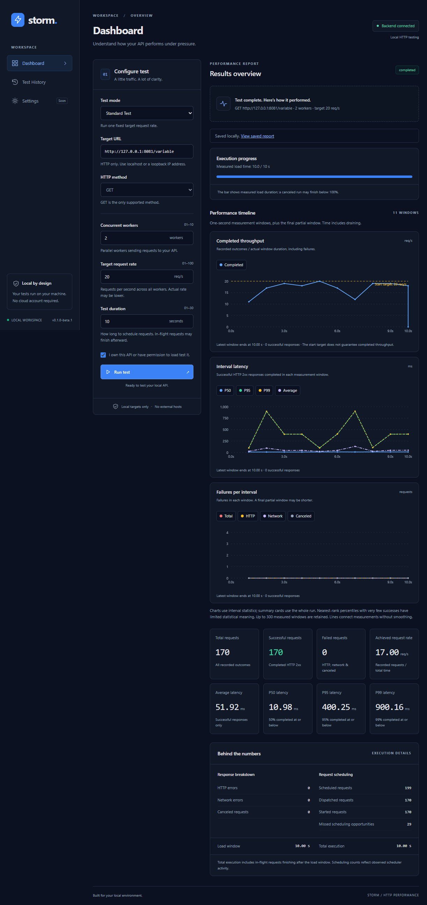
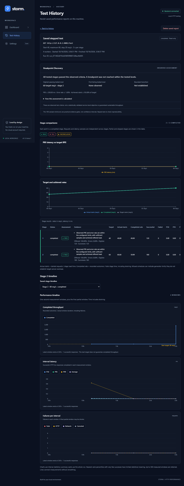
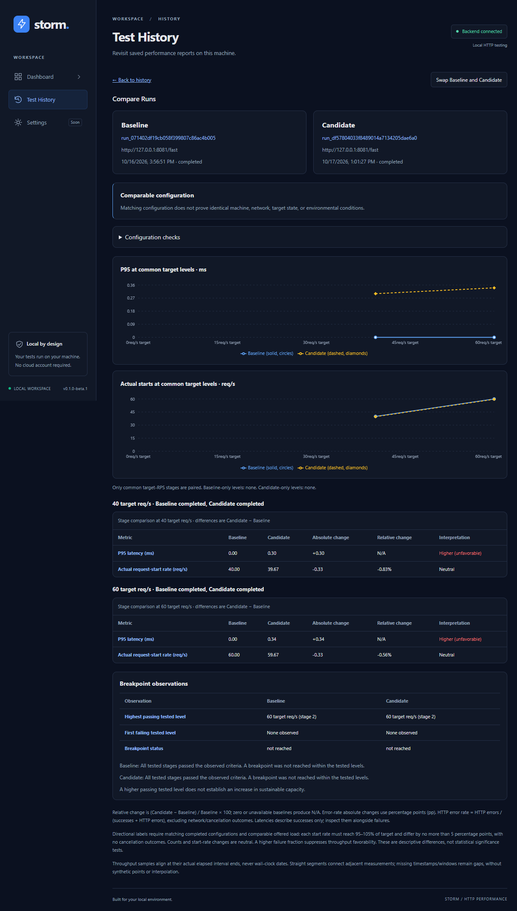

# Storm — Find your API's limits before your users do.

A local-first HTTP performance testing tool with a Go engine and an embedded React dashboard. Run controlled load tests, watch latency distributions change, and compare saved reports—all on your machine.

**Windows beta candidate: v0.1.0-beta.1 · GET only · Loopback targets only · MIT**



## Explore performance, with context

- **Standard and stepped tests:** configure workers and a global target request rate.
- **Live charts:** completed throughput, interval P50/P95/P99 latency, and failures.
- **Start/Stop:** asynchronous execution, cancellation, and graceful draining.
- **Breakpoint Discovery:** assess tested stages against your thresholds, with explicit inconclusive results when evidence is insufficient.
- **Local history and comparisons:** SQLite reports survive restarts; compare baseline and candidate configurations and measurements.
- **One Windows executable:** dashboard assets and SQLite driver included. No Go, Node.js, GCC, Vite, or database installation needed to run Storm.

The tagline is an invitation to investigate, not a claim of guaranteed capacity. Generator saturation is not proof of server overload.

<details><summary>More real screenshots</summary>




Screenshots show actual local measurements; they are not product performance benchmarks.
</details>

## Windows download and launch

**The beta is prepared locally but has not been published.** Once approved, the ZIP and SHA-256 file will be available on the [GitHub Releases page](https://github.com/asralov/storm/releases). Until then, build from source below.

1. Download `storm-v0.1.0-beta.1-windows-amd64.zip` and its `.sha256` file from the approved release.
2. Compare `Get-FileHash .\storm-v0.1.0-beta.1-windows-amd64.zip -Algorithm SHA256` with the published checksum.
3. Extract the archive and run `storm.exe`. Open the printed loopback address if the browser does not open.

```powershell
.\storm.exe --port 8080
.\storm.exe --port 8090 --no-browser
.\storm.exe --port 0 --no-browser  # choose an available port
.\storm.exe --version
```

The executable is **unsigned**. Windows may show reputation warnings; verify the source and checksum rather than disabling security protections. Press **Ctrl+C** in Storm's console to cancel active work and save its final report. Closing the browser does not stop the server. One instance may own the history database at a time.

## Try a local test

Start an API you own on your machine, enter its HTTP URL, confirm authorization, and choose **Run test**. For repeatable demos, run the optional Storm Lab from a source checkout:

```powershell
cd backend
go run ./cmd/storm-lab
```

| Target on `http://127.0.0.1:8081` | Behavior |
| --- | --- |
| `/fast` | Lightweight JSON |
| `/slow?ms=100` | Fixed delay, capped at 1500 ms |
| `/variable` | Deterministic mixture of 10/100/400/900 ms responses |
| `/errors?percent=20` | Reproducible HTTP 500 mixture |
| `/degrade` | Bounded queue and two service slots |

The bare `/` path is not a workload. Storm Lab is separate from Storm and is not required to launch it. The beta ZIP includes Storm only; use your own local API or build Lab from source. See [lab details](docs/performance-lab.md).

## Build from source

Build prerequisites: Node.js 22.12 or newer within the Node 22.x range with npm and the Go version in [go.mod](backend/go.mod). Windows packaging uses PowerShell. Stop any running Storm executable and Vite before rebuilding. Node.js 22.17.0 was the development version reported as tested. Node.js is a source-development/build prerequisite, not a requirement for the standalone Windows executable.

```powershell
node scripts/build.mjs
node scripts/smoke-windows.mjs
```

The build uses `npm ci`, compiles React, copies fresh assets into Go's embedding directory, and builds Windows AMD64 with **CGO disabled**. It produces the executable, ZIP, checksum, build metadata, and third-party notices under `release/`. [VERSION](backend/internal/buildinfo/VERSION) is the single application-version source. Other GOOS/GOARCH build targets are source-level options, not verified releases.

## Development

Run in separate terminals:

```powershell
go -C backend run ./cmd/storm-server
npm --prefix frontend ci
npm --prefix frontend run dev
```

Open `http://localhost:5173`. Vite preserves Host and Origin when proxying `/api` to `127.0.0.1:8080`. Production serves the same API and compiled dashboard from Go. See [CONTRIBUTING](CONTRIBUTING.md) for checks and review expectations.

## How it works

A local REST API validates configuration and admits one job at a time. The manager runs each stage through the same global scheduler, worker pool, and collector. React polls measured snapshots; terminal reports are saved transactionally to SQLite. Production embeds Vite assets in the executable. [Architecture and measurement definitions](docs/architecture.md) explain the boundaries and rate denominators.

## Privacy and safety

No accounts, telemetry, or cloud service. Tests and reports stay local. URLs—including query strings—are stored **unencrypted**; do not place secrets in them. History grows until you delete reports.

| Platform | SQLite location |
| --- | --- |
| Windows | `%LOCALAPPDATA%\Storm\history.sqlite3` |
| macOS (unverified runtime) | `~/Library/Application Support/Storm/history.sqlite3` |
| Linux (unverified runtime) | `$XDG_DATA_HOME/storm/history.sqlite3`, or `~/.local/share/storm/history.sqlite3` |

Only authorized **HTTP GET** to localhost or loopback IPs is supported. No remote hosts, HTTPS targets, request bodies, or redirects. Defaults bind the API to loopback; Host/Origin checks guard browser access. These protections are not authentication against local native programs. Do not expose Storm through a public/LAN proxy. See [SECURITY](SECURITY.md).

## Testing

```powershell
go -C backend test ./...
go -C backend test -race ./...  # requires a supported C compiler for this check only
go -C backend vet ./...
npm --prefix frontend run lint
npm --prefix frontend run build
npm --prefix frontend test
node scripts/smoke-windows.mjs  # after a release build
```

The smoke test copies the executable outside the repository and uses isolated temporary history. See [release audit](docs/release-audit.md), [release preparation](docs/release-preparation.md), and the unchecked [clean Windows checklist](docs/clean-windows-checklist.md).

## Status and limitations

Phase 7B concluded **Ready with caveats**. Windows AMD64 was exercised on a development machine outside the repository; a clean Windows 11 VM is still outstanding. macOS/Linux binaries are **not verified**. The beta is unsigned and has no installer or updater.

Limits: 1–10 workers, 1–100 target RPS, 1–30 seconds per stage, up to 10 stepped stages and 120 seconds configured stepped load. Request timeout is two seconds. Latency describes successful, fully read responses only. Short tests, shared-machine load, missed scheduler ticks, and generator limits constrain conclusions. Older reports retain their original measurement semantics. Forced termination can lose unsaved measurements.

Near-term roadmap: complete clean Windows acceptance, review release materials, approve the beta, and gather reproducible feedback. Cross-platform verification and signing remain future work; no remote-host roadmap commitment is implied.

Licensed under the existing [MIT License](LICENSE). [Changelog](CHANGELOG.md) · [Release notes](docs/release-notes.md) · [History](docs/persistent-history.md) · [Comparisons](docs/run-comparisons.md)

Current candidate verification and publication gates: [final release checklist](docs/final-release-checklist.md).
