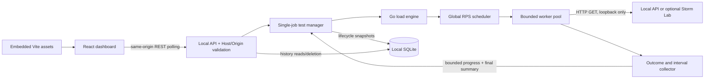

# Architecture

Storm separates measurement, orchestration, persistence, and presentation so load execution never depends on a browser, HTTP handler, or database write.

- **Engine:** creates request contexts, transport, workers and collector for each run/stage. It has no storage, HTTP-server or React dependency. Redirects and proxies are disabled; dialing checks loopback again and pins localhost.
- **Scheduler:** one ticker for the entire test offers work to available workers. It does not multiply RPS by worker count or queue unlimited requests.
- **Workers:** concurrency is bounded; every started request emits exactly one outcome after body reading. Normal load expiry permits a three-second drain, subject to the two-second request timeout. Explicit cancellation interrupts active work.
- **Collector:** owns counters and successful latency samples, avoiding concurrent mutation. Progress delivery never blocks requests. Intervals use completion timestamps, a bounded retained timeline, and nearest-rank percentiles over only that window.
- **Manager:** owns IDs, lifecycle, cancellation and the one-active-job slot. Stepped stages reuse the engine sequentially and clean up before the next stage. It exposes copied snapshots and delegates deterministic threshold analysis to a separate package.
- **API:** validates JSON, limits, authorization, Host and Origin. Start returns 202; reads return progress/final results; Stop acknowledges a request to cancel. No streaming or WebSockets.
- **React:** polls every approximately 750 ms, recovers active jobs, draws measured intervals, and presents saved reports and comparisons. It does not generate measurements or duplicate backend assessment rules.
- **Storage:** pure-Go SQLite, versioned snapshots, transactional writes, WAL/FULL and bounded queries. Writes happen before execution and after finalization, outside the request hot path. An OS-held database lock prevents competing recovery. Abnormal shutdown leaves an interrupted marker, not fabricated final data.
- **Production:** the build copies Vite output inside the Go module; `go:embed` bundles it. Static serving never falls back to HTML for API paths. Development keeps Vite's proxy while sharing the Go application lifecycle.
- **Lab:** separate optional bounded loopback server with repeatable workloads. It is a target, not part of the orchestration or production startup dependency chain.

## Rates and accounting

| Term | Exact meaning |
| --- | --- |
| Target RPS | Requested global start schedule; neither achieved throughput nor guaranteed capacity |
| Scheduled | Observed ticker opportunities; delayed/coalesced ideal ticks are not reconstructed |
| Dispatched | Worker handoffs accepted |
| Missed | Observed opportunity with no worker available |
| Started | Worker entered request execution after its cancellation check |
| Completed / requests | Recorded outcomes, including failures and cancellations |
| Observed start rate | Started / measured active load seconds, frozen during drain |
| Legacy attempted RPS | Final recorded outcomes / active load seconds; equals start rate when final accounting holds |
| Completed throughput | All recorded outcomes / total engine time including drain; not success-only goodput |
| Interval throughput | Outcomes completed in a window / actual window duration |

Final invariants: `scheduled = dispatched + missed`, `started <= dispatched`, `started = requests = successes + failures`, and `failures = HTTP errors + transport errors + cancellations`.

Fully read non-2xx responses (including redirects) are HTTP failures. Connection refusal, truncated bodies and independent client timeouts are transport failures. Explicit run termination is cancellation. Successful-response latency includes the full body and uses nearest rank `ceil(p*n)-1` on sorted samples. No successes means unavailable latency, not a zero measurement. Whole-run percentiles are never averages of interval percentiles.

The assessment failure denominator is successes + HTTP errors + transport errors; cancellation makes a stage inconclusive. Comparison's HTTP-only rate excludes transport errors. Charts may correct late-delivered outcomes; short final windows can show noisy rates. A generator shortfall does not demonstrate server overload. Threshold crossings are observations, not statistical SLO certification or maximum sustainable throughput. See the [audit](release-audit.md) for the complete contract and historical-report limitations.
